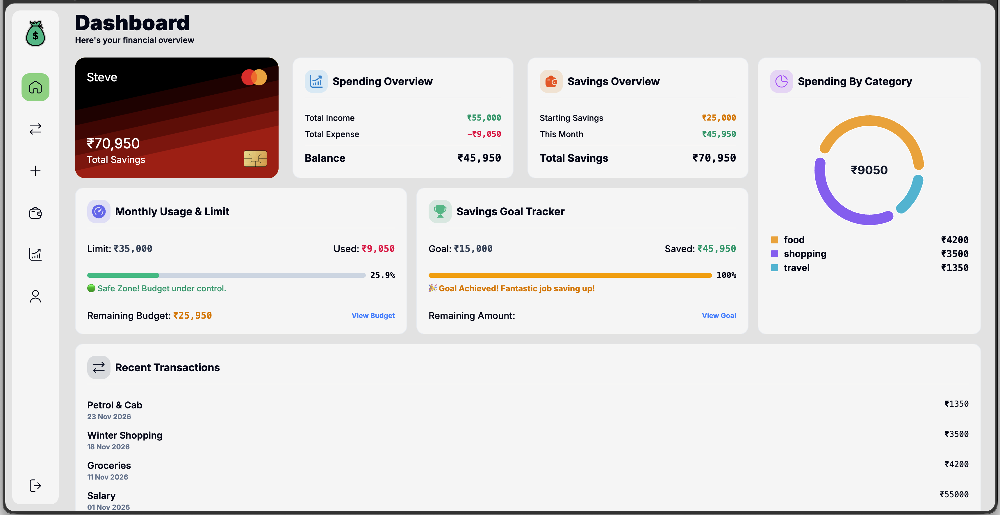
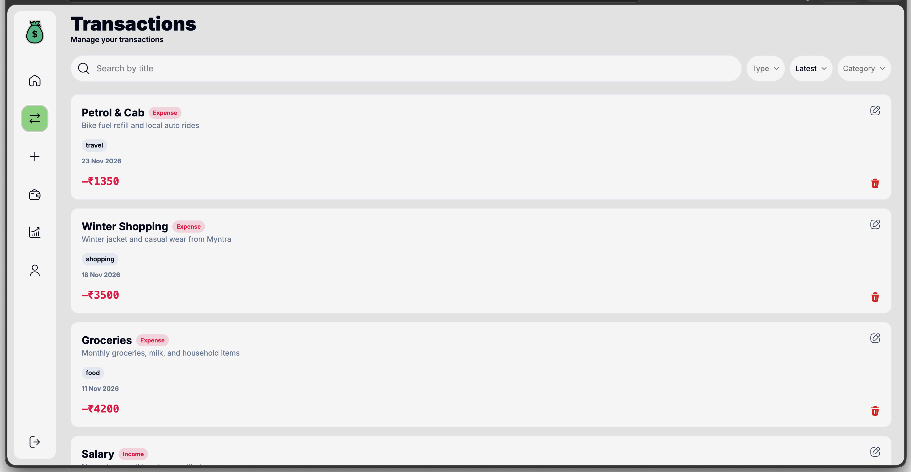
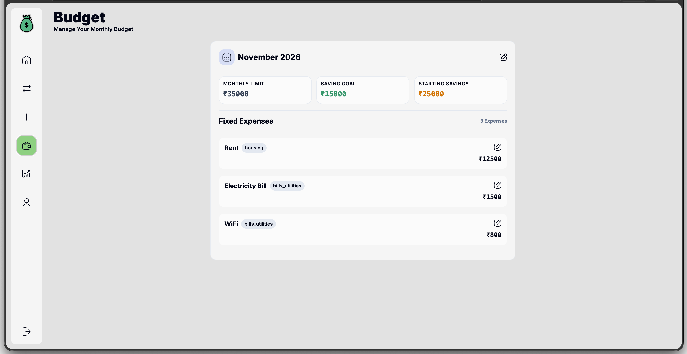
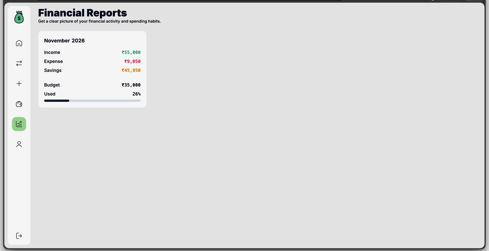
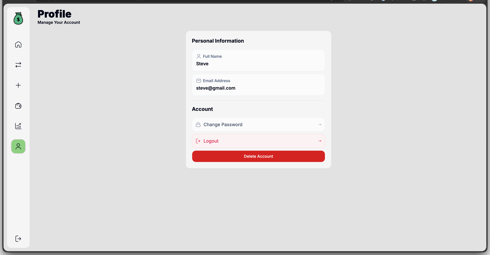
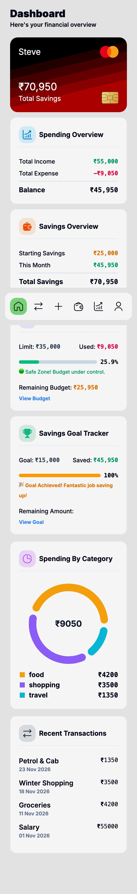
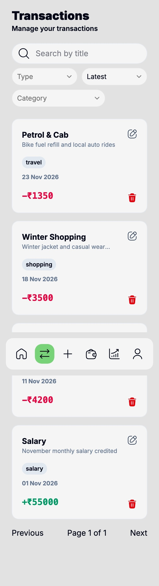

# Expense Tracker

A full-stack MERN application to manage personal finances, track daily expenses, create monthly budgets, and analyze spending through interactive reports.

[Live Demo](https://expense-tracker-amber-seven-60.vercel.app/) · [GitHub Repository](https://github.com/bkumbhare11/Expense-Tracker)

## Screenshots

### Desktop View

|                 Dashboard                 |                  Transactions                   |
| :---------------------------------------: | :---------------------------------------------: |
|  |  |

|               Budget                |
| :---------------------------------: |
|  |

|                Reports                |                Profile                |
| :-----------------------------------: | :-----------------------------------: |
|  |  |

### Mobile View

|                        Dashboard                        |                         Transactions                          |
| :-----------------------------------------------------: | :-----------------------------------------------------------: |
|  |  |

## Features

- **User Authentication:** Secure registration and login using JWT and HTTP-only cookies.
- **Password Management:** Forgot password, email-based password reset, and password change functionality.
- **Dashboard:** View financial summaries and recent transactions.
- **Transaction Management:** Add, view, update, and delete income and expense transactions.
- **Monthly Budget Management:** Set monthly budgets and manage fixed expenses.
- **Spending Reports:** Analyze expenses through visual reports.
- **Input Validation:** Validate user input using Zod.
- **Account Management:** Permanently delete an account along with its associated transactions and budgets.
- **Responsive UI:** Designed to work across desktop and mobile devices.

## Tech Stack

### Frontend

- React.js
- Vite
- Tailwind CSS
- shadcn/ui
- React Router
- React Hook Form
- Axios
- Zod
- Recharts
- React Hot Toast

### Backend

- Node.js
- Express.js
- MongoDB
- Mongoose
- JWT Authentication
- bcrypt
- Cookie Parser
- Nodemailer
- Zod

### Tools & Deployment

- Git & GitHub
- Postman
- Vercel (Frontend)
- Render (Backend)
- MongoDB Atlas (Database)

## Project Structure

```text
Expense-Tracker/
│
├── backend/
│   ├── controllers/
│   ├── models/
│   ├── routes/
│   ├── middleware/
│   ├── config/
│   ├── utils/
│   └── server.js
│
├── frontend/
│   ├── src/
│   │   ├── components/
│   │   ├── pages/
│   │   ├── context/
│   │   ├── services/
│   │   └── ...
│   └── package.json
│
├── screenshots/
├── .gitignore
└── README.md
```

## Installation & Setup

### 1. Clone the Repository

```bash
git clone https://github.com/bkumbhare11/Expense-Tracker.git
cd Expense-Tracker
```

### 2. Backend Setup

```bash
cd backend
npm install
```

Create a `.env` file inside the backend folder:

```env
PORT=3000
MONGO_URI=your_mongodb_connection_string
JWT_SECRET=your_jwt_secret
EMAIL_USER=your_email
EMAIL_PASS=your_email_app_password
CLIENT_URL=http://localhost:5173
NODE_ENV=development
```

Start the backend server:

```bash
npm run dev
```

### 3. Frontend Setup

Open another terminal:

```bash
cd frontend
npm install
```

Create a `.env` file inside the frontend folder:

```env
VITE_API_URL=http://localhost:3000/api
```

Start the frontend development server:

```bash
npm run dev
```

The application will be available at:

```text
http://localhost:5173
```

## Environment Variables

| Variable       | Description                                    |
| -------------- | ---------------------------------------------- |
| `PORT`         | Backend server port                            |
| `MONGO_URI`    | MongoDB connection string                      |
| `JWT_SECRET`   | Secret key for JWT authentication              |
| `EMAIL_USER`   | Email account used for password reset          |
| `EMAIL_PASS`   | Email app password                             |
| `CLIENT_URL`   | Frontend URL for CORS and password reset links |
| `NODE_ENV`     | Application environment                        |
| `VITE_API_URL` | Backend API base URL for frontend              |

**Note:** Never commit `.env` files or expose your credentials publicly.

## Authentication & Security

- JWT-based authentication.
- HTTP-only cookies for storing authentication tokens.
- Secure and cross-site cookie configuration in production.
- Protected API routes using authentication middleware.
- Password hashing using bcrypt.
- Request validation using Zod.
- CORS configured with credentials.

## Deployment

- **Frontend:** Vercel
- **Backend:** Render
- **Database:** MongoDB Atlas

## Author

**Bhavesh Kumbhare**

[GitHub](https://github.com/bkumbhare11) · [LinkedIn](www.linkedin.com/in/bhavesh-kumbhare-552a4a2b0)

---

If you find this project useful, consider giving the repository a ⭐.
